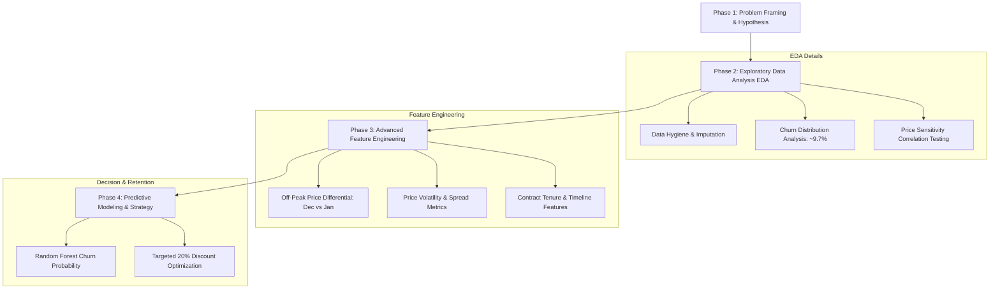
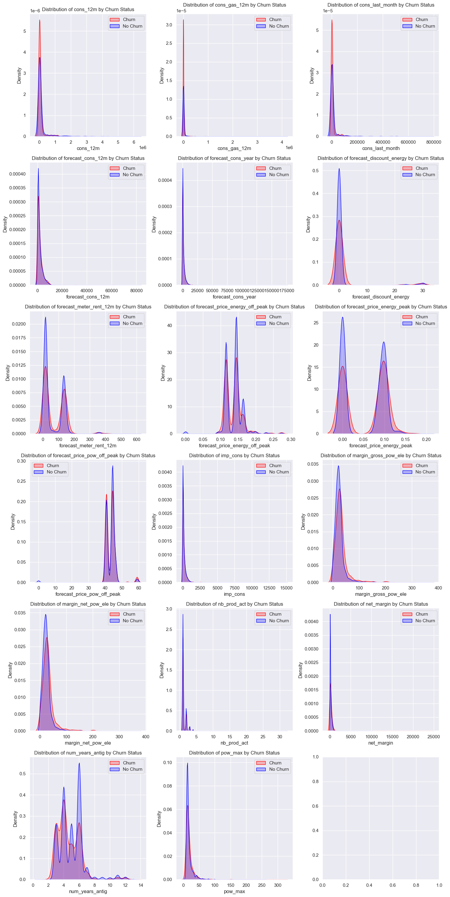
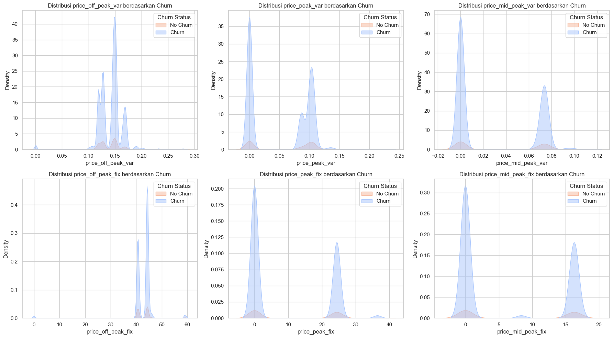

# ⚡ PowerCo Customer Churn Analytics & Price Sensitivity Modeling

[](https://www.python.org/)
[](https://jupyter.org/)
[](https://scikit-learn.org/)
[](https://www.theforage.com/simulations/bcg/data-science-ccdz)
[](LICENSE)

> **Applied Data Science & Management Consulting Simulation**: End-to-end diagnostic, exploratory data analysis, price sensitivity hypothesis testing, and feature engineering for **PowerCo**, a premier European gas and electricity utility. Developed as part of the **BCG X Data Science Virtual Experience Program** on Forage.

---

## 📌 Executive Summary

The European energy market has undergone extensive deregulation, empowering Small and Medium Enterprises (SMEs) to switch utility providers with minimal frictional cost. In response to rising customer attrition, **PowerCo** partnered with **BCG X** (Boston Consulting Group's analytics arm) to diagnose whether customer churn is predominantly driven by **price sensitivity** and to establish an algorithmic retention mechanism.

### Key Highlights
- **Target Variable**: Binary customer churn over a forward-looking 3-month horizon (`churn` = `1` vs `0`).
- **Observed Churn Rate**: **~9.7%** baseline customer attrition across 14,606 SME accounts, representing a substantial revenue and margin drain.
- **Core Hypothesis Result**: **Price sensitivity alone is NOT the primary driver of churn.** Although marginal tariff spikes between December and January correlate with departures in specific sub-segments, tenure antiquity, gross margin per power unit, and contract renewal proximity demonstrate stronger predictive importance.

---

## 🏢 Business Problem & Analytical Framework

PowerCo's commercial leadership initially hypothesized that price competition was the sole mechanism driving customer attrition:

$$\text{Hypothesis: } \text{Churn} = f(\Delta \text{Price}_{\text{energy}}, \Delta \text{Price}_{\text{power}})$$

To rigorously test this hypothesis, the analysis was broken down into a 4-phase framework:



---

## 📊 Exploratory Data Analysis & Strategic Insights

### 1. Overall Churn Distribution
The SME customer base exhibits an imbalanced distribution where **~9.7%** of enterprise clients churned.



*Figure 1: Baseline customer churn rate (~9.7% churned vs ~90.3% retained).*

### 2. Price Distribution & Sensitivity Testing
Examining energy tariffs (variable prices) and power subscription fees (fixed charges) across off-peak, peak, and mid-peak periods reveals that the distributions for churned and retained customers overlap almost entirely.



*Figure 2: Distribution of variable energy tariffs and fixed power fees across peak tiers.*

### 3. Key Analytical Takeaways
1. **Weak Direct Price Correlation**: Correlation between standalone baseline prices and churn is near zero ($|r| < 0.05$). Churn is not a simple linear function of raw energy rates.
2. **Impact of Price Changes (The "Dec vs Jan" Effect)**: Customers experiencing sharp price increases between the start (January) and end of the year (December) display higher churn probability.
3. **Tenure & Relationship Age**: Clients with shorter contract history (`num_years_antig` $\le 3$) churn at twice the rate of long-term entrenched accounts.
4. **Product Bundling (`has_gas`)**: Accounts subscribing exclusively to electricity churn at a significantly higher rate than dual-fuel (electricity + gas) accounts, signaling strong cross-product stickiness.

---

## 🛠️ Feature Engineering Methodology

To capture non-linear interactions and uncover price sensitivity, multiple specialized feature sets were engineered in [`notebooks/02_feature_engineering.ipynb`](notebooks/02_feature_engineering.ipynb):

### 1. Price Delta Features (Off-Peak Price Shock)
Quantifying the shift in energy rates between the beginning and ending periods of the preceding fiscal year:

$$\Delta \text{Price}_{\text{energy}} = \text{Price}_{\text{off\_peak, Dec}} - \text{Price}_{\text{off\_peak, Jan}}$$

$$\Delta \text{Price}_{\text{power}} = \text{Price}_{\text{off\_peak\_fix, Dec}} - \text{Price}_{\text{off\_peak\_fix, Jan}}$$

### 2. Rolling Price Volatility
- 6-month and 3-month variance across off-peak, peak, and mid-peak prices to capture sudden tariff instabilities.

### 3. Contract & Temporal Dynamics
- **Contract Duration**: Total tenure from `date_activ` to `date_end`.
- **Time to Renewal**: Days remaining until contract renewal (`date_renewal`), identifying imminent decision points.
- **Modification Recency**: Days elapsed since the last product or plan modification (`date_modif_prod`).

### 4. Consumption & Margin Elasticity
- Ratio of off-peak energy usage to total annual consumption.
- Ratio of net margin to gross margin (`net_margin / margin_gross_pow_ele`).

---

## 📂 Repository Directory Structure

This project adheres to the standard **Cookiecutter Data Science** architecture, engineered for clean separation of concerns, reproducibility, and enterprise deployment:

```text
PowerCo/
├── data/
│   ├── raw/                           # Original, immutable benchmark datasets
│   │   ├── client_data.csv            # SME client attributes, contract & consumption data
│   │   ├── price_data.csv             # Historical monthly energy & power price records
│   │   └── .gitkeep                   # Preserves folder structure in git
│   ├── processed/                     # Cleaned, imputed, and transformed datasets
│   │   ├── clean_data_after_eda.csv   # Post-EDA cleansed dataset for feature engineering
│   │   └── .gitkeep                   # Preserves folder structure in git
│   └── interim/                       # Intermediate artifacts and caching
│       └── .gitkeep                   # Preserves empty folder in git
├── docs/                              # Project documentation & data dictionaries
│   ├── Data Description.pdf           # Original client data documentation from BCG X
│   ├── data_dictionary.md             # Comprehensive markdown reference of all features
│   └── problem_statement.md           # Business context, hypothesis framing & scope
├── models/                            # Serialized model binaries (.pkl, .joblib)
│   └── .gitkeep                       # Keeps models directory tracked (weights are gitignored)
├── notebooks/                         # Ordered Jupyter Notebooks for analysis
│   ├── 01_exploratory_data_analysis.ipynb # Task 2: Data cleaning, univariate/bivariate EDA
│   └── 02_feature_engineering.ipynb       # Task 3: Signal extraction & price shock modeling
├── reports/                           # Analysis outputs, figures, and deliverables
│   ├── figures/                       # Rendered plots, distributions, and visuals
│   │   ├── ChurnVsNochurn.png
│   │   ├── Pricedf.png
│   │   ├── Total.png
│   │   └── .gitkeep
│   └── problem_statement.md           # Detailed business problem statement
├── .gitignore                         # Excludes checkpoints, virtualenvs, and models
├── README.md                          # Executive project documentation
└── requirements.txt                   # Reproducible Python dependencies
```

---

## ❓ Why `.gitkeep` is Used in this Project

In Git's internal object model, **directories are not tracked as independent entities**; Git only tracks files and their directory paths. Consequently, if a directory is completely empty, Git ignores it entirely.

In professional Data Science and Machine Learning repositories, several directories are essential for downstream workflows:
- **`models/`**: Holds serialized model artifacts (`.pkl`, `.joblib`). Because large binary models should **not** be checked into Git history (they are excluded via `.gitignore`), the `models/` directory would vanish on remote clones without a placeholder.
- **`data/interim/`**: Holds temporary batch processing artifacts and pipeline caches.
- **`reports/figures/`**: Holds dynamically rendered plots from automated batch scripts.

By placing a `.gitkeep` file (a zero-byte convention marker) in these folders:
1. The full directory tree is preserved across `git clone`, `git checkout`, and CI/CD runners.
2. Machine learning pipelines and export scripts avoid runtime `FileNotFoundError` exceptions when writing models or figures.

---

## 🚀 Quickstart & Reproduction

### Prerequisites
- Python 3.10 or higher
- Git

### 1. Clone the Repository
```bash
git clone https://github.com/Akma86/powerco-customer-churn-prediction.git
cd powerco-customer-churn-prediction
```

### 2. Create and Activate a Virtual Environment
```bash
# Windows (PowerShell)
python -m venv .venv
.\.venv\Scripts\Activate.ps1

# Linux / macOS
python3 -m venv .venv
source .venv/bin/activate
```

### 3. Install Required Dependencies
```bash
pip install --upgrade pip
pip install -r requirements.txt
```

### 4. Launch Jupyter Notebooks
```bash
jupyter notebook notebooks/
```
- Open `01_exploratory_data_analysis.ipynb` to inspect data cleaning, outlier treatment, and bivariate distributions.
- Open `02_feature_engineering.ipynb` to review price differential formulations and feature engineering pipelines.

---

## 📈 Strategic Recommendations & Next Steps

1. **Targeted Retention Interventions**: Rather than broad price cuts that erode operating margins, offer a **targeted 20% discount** strictly to customers in the top decile of churn risk whose renewal dates fall within 90 days.
2. **Promote Dual-Fuel Adoption**: Incentivize electricity-only customers to bundle gas services (`has_gas`), effectively closing the retention gap.
3. **Onboarding Tenure Stabilization**: Introduce proactive loyalty touchpoints during the first 12-24 months of customer onboarding to counteract the high early-tenure attrition rate.

---

## 📜 License

This project is licensed under the **MIT License** - see the [LICENSE](LICENSE) file for details.

## 🤝 Acknowledgments
- **BCG X (Boston Consulting Group)** for designing the simulation scenario and problem dataset.
- **Forage** for hosting the Data Science Virtual Experience Program.
