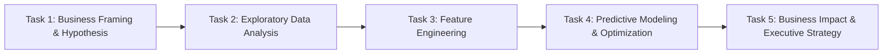

# BCG X & PowerCo: Business Problem Statement & Analytical Framework

## 1. Executive Context

**PowerCo** is a leading gas and electricity utility servicing small-to-medium enterprise (SME) customers across Europe. Following the liberalization and deregulation of the commercial energy market, customer switching behaviors have increased dramatically. As competition intensifies, PowerCo is confronting a steady erosion of its SME customer base due to customer churn.

PowerCo's executive leadership team has partnered with **BCG X** (Boston Consulting Group's data science & advanced analytics division) to diagnose the root causes of customer attrition and engineer an intelligent retention strategy.

---

## 2. The Core Hypothesis

> **"Customer churn at PowerCo is predominantly driven by customer price sensitivity."**

PowerCo's commercial team hypothesizes that customers churn when energy tariffs increase or when competing providers offer slightly lower rates. However, in enterprise and SME utilities, churn is frequently multi-dimensional, influenced by:
- Customer tenure & relationship antiquity
- Contract life cycle (nearing renewal or modification dates)
- Gas-electricity product bundling (`has_gas`)
- Forecasted consumption deviations vs historical usage
- Channel acquisition efficiency

---

## 3. Key Analytical Objectives

1. **Verify Price Sensitivity Hypothesis**: Conduct extensive exploratory data analysis (EDA) and hypothesis testing to evaluate whether price variation directly correlates with customer departure.
2. **Feature Engineering**: Formulate predictive signals quantifying price dynamics (e.g., December vs. January off-peak price shifts, peak-to-off-peak ratios, margin elasticity, and tenure indicators).
3. **Predictive Modeling**: Train an interpretable yet high-capacity Machine Learning model (Random Forest Classifier) to compute the probability of a client churning within a 3-month forecast window.
4. **Strategic Intervention & Discount Strategy**: Deliver actionable recommendations to PowerCo's leadership regarding customer retention:
   - Calculate the financial trade-off of offering targeted discounts (e.g., 20% discount on contract renewal) to high-risk customers.
   - Prevent margin cannibalization by avoiding blanket discounts to clients who would have stayed regardless.

---

## 4. Analytical Roadmap

- **Task 1: Business Understanding & Hypothesis Framing** — Formalize the problem statement, define the target variable (`churn`), and outline required data streams.
- **Task 2: Exploratory Data Analysis (EDA)** — Cleanse data, examine univariate and bivariate distributions, analyze churn rates across customer segments, and visualize correlation heatmaps.
- **Task 3: Feature Engineering** — Synthesize historical pricing signals (month-over-month price changes, peak vs off-peak spreads, contract timeline features).
- **Task 4: Predictive Modeling** — Address class imbalance (churn rate ~9.7%), train a Random Forest classifier, evaluate via Precision, Recall, and ROC-AUC metrics, and rank feature importance.
- **Task 5: Business Communication** — Synthesize findings into an executive briefing outlining customer targeting criteria and return-on-investment (ROI) calculations.
